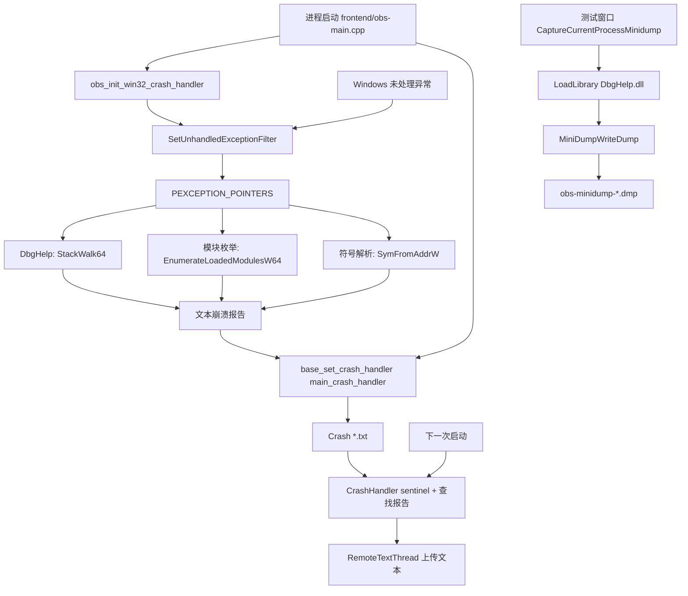

# OBS 崩溃处理器链路

> 这份文档基于当前工作区代码（2026-10-31）整理。重点回答：异常上下文如何进入处理器、如何解析故障模块和符号、文本报告与 Dump API 分别在哪里生成，以及报告如何在下一次启动时被发现和上传。

## 1. 范围与结论

- **事实（高置信度）**：Windows 有一条由 `SetUnhandledExceptionFilter` 驱动的原生异常链，输入是 `PEXCEPTION_POINTERS`，输出是 `obs-studio/crashes/Crash *.txt` 文本报告。
- **事实（高置信度）**：Windows 处理器会从异常上下文读取指令指针和栈寄存器，使用 DbgHelp 的 `StackWalk64`、`EnumerateLoadedModulesW64` 和 `SymFromAddrW` 得到模块名、符号名和偏移。
- **事实（高置信度）**：测试窗口的 `CaptureCurrentProcessMinidump` 是另一条链路，直接调用 `MiniDumpWriteDump`；当前传入的 `MINIDUMP_EXCEPTION_INFORMATION` 为 `nullptr`，因此它不是异常回调中的上下文 Dump。
- **事实（高置信度）**：Windows 文本报告由 `main_crash_handler` 落盘，`CrashHandler` 在下一次启动时识别上次异常并可上传；Dump 文件不会被这套上传逻辑自动识别。
- **事实（高置信度）**：Linux 和 FreeBSD 的 `CrashHandler` 平台实现目前返回空路径；macOS 读取系统生成的 `~/Library/Logs/DiagnosticReports/OBS*.ips`，没有在 OBS 内注册同等的异常上下文回调。

## 2. 全局组件图



### 2.1 组件职责

| 组件 | 责任 | 主要产物 |
| --- | --- | --- |
| `libobs/obs-win-crash-handler.c` | 接收 Windows 未处理异常，读取上下文，生成线程栈、模块列表和符号文本 | 内存中的报告字符串 |
| `libobs/util/base.c` | 提供 `bcrash` 和可替换的进程级 crash callback | 将报告转交给前端回调 |
| `frontend/obs-main.cpp` | 把回调文本写入文件，展示路径并可复制到剪贴板 | `Crash *.txt` |
| `frontend/utility/CrashHandler.*` | 用 sentinel 判断异常退出，查找最近报告，上传和保存上传状态 | 上传 URL、配置项 |
| `frontend/utility/Minidump.cpp` | 手工抓取当前进程 Dump | `obs-minidump-*.dmp` |
| Windows `DbgHelp.dll` | 提供栈回溯、模块枚举、符号查询和 `MiniDumpWriteDump` | 调试信息或二进制 Dump |

## 3. Windows 原生异常链

### 3.1 注册与触发

1. `frontend/obs-main.cpp:929` 调用 `obs_init_win32_crash_handler()`。
2. `libobs/obs-windows.c:1216-1219` 转调 `initialize_crash_handler()`。
3. `libobs/obs-win-crash-handler.c:526-533` 使用 `SetUnhandledExceptionFilter(exception_handler)` 注册顶层 SEH 处理器。
4. 同一启动阶段 `frontend/obs-main.cpp:935` 调用 `base_set_crash_handler(main_crash_handler, nullptr)`，把 `bcrash` 的输出接到前端。
5. 发生未处理 SEH 时，Windows 调用 `exception_handler(PEXCEPTION_POINTERS exception)`。处理器会跳过“存在调试器”的进程，并用 `InterlockedCompareExchange(&inside_handler, 1, 0)` 原子地限制并发和递归进入（`obs-win-crash-handler.c`）。

**因果链（事实，高置信度）**：未处理异常 -> `EXCEPTION_POINTERS` -> `handle_exception` 先写入上下文 minidump，再生成报告字符串 -> `bcrash("%s", ...)` -> `main_crash_handler` 写文本文件并退出。

### 3.2 并发与临界区

`exception_handler` 使用进程级原子门控：第一个异常线程通过 `InterlockedCompareExchange(&inside_handler, 1, 0)` 将 `inside_handler` 从 `0` 改为 `1`，负责写入一次 minidump 和文本报告；其他同时进入或递归进入的线程读取到非零值后立即返回 `EXCEPTION_CONTINUE_SEARCH`。这避免了重复文件写入和多个 `bcrash` 调用。

处理器退出前使用 `InterlockedExchange(&inside_handler, 0)` 原子地释放门控；它会直接写入新值，不依赖旧值是否仍为 `1`。由于 `bcrash` 标记为不返回，正常崩溃路径会在复位前终止进程，这个复位主要覆盖防御性返回路径。

这里使用 `InterlockedCompareExchange` 和 `InterlockedExchange`，而不是普通 `bool` 判断或 `CRITICAL_SECTION`：前者将判断与占用合并为不可分割的原子操作，后者用于无条件原子释放；同时崩溃线程不应等待可能由另一个已损坏线程持有的锁。原子门控只位于异常路径，正常运行不产生锁竞争。

### 3.3 异常上下文如何变成指令地址

`handle_exception`（`obs-win-crash-handler.c:485-501`）保存：

- `data->exception = exception`，保留 `ExceptionRecord` 和 `ContextRecord`；
- `data->main_trace.context = *exception->ContextRecord`，复制崩溃线程寄存器；
- `init_instruction_data` 根据架构读取寄存器：
  - ARM64：`Pc`、`Fp`、`Sp`；
  - x64：`Rip`、`Rbp`、`Rsp`；
  - x86：`Eip`、`Ebp`、`Esp`。

这些字段写入 `STACKFRAME64`，并设置 `AddrPC`、`AddrFrame`、`AddrStack` 为平坦地址模式（`obs-win-crash-handler.c:139-164`）。报告头随后输出异常码、故障地址、当前模块名、libobs 版本、Windows 版本和 CPU（`obs-win-crash-handler.c:241-269`）。

### 3.3 DbgHelp 加载与符号初始化

处理器没有静态依赖 DbgHelp 的导入符号，而是：

1. `LoadLibraryW(L"DbgHelp")`；
2. 用 `GetProcAddress` 动态取得 `SymInitialize`、`SymRefreshModuleList`、`StackWalk64`、`EnumerateLoadedModulesW64`、`SymFromAddrW` 和 `MiniDumpWriteDump` 等函数（`obs-win-crash-handler.c:118-136`）；
3. 设置 `SYMOPT_UNDNAME | SYMOPT_FAIL_CRITICAL_ERRORS | SYMOPT_LOAD_ANYTHING`；
4. 如果 `sym_initialize_called == false`，调用 `SymInitialize(process, NULL, true)`；否则调用 `SymRefreshModuleList`（`obs-win-crash-handler.c:166-180`）。

**事实（高置信度）**：`SymInitialize` 的搜索路径由 `libobs/obs-windows.c:1105-1212` 的 `reset_win32_symbol_paths` 预先设置。它在 `obs_post_load_modules` 中调用（`libobs/obs-module.c:620-630`），把当前目录和已加载模块的二进制目录拼成搜索路径，并调用 `SymInitializeW` 或 `SymSetSearchPathW`。

**边界（高置信度）**：符号能否解析依赖 PDB 可用、地址属于已加载模块以及 DbgHelp 能访问搜索路径。无法解析时报告仍保留模块或地址，但不保证有函数名。

### 3.4 从地址到模块名、符号名

对每一个线程，`walk_stack`（`obs-win-crash-handler.c:294-365`）执行：

1. `StackWalk64` 从当前 `STACKFRAME64` 推进到下一帧；
2. 以该帧 PC 地址调用 `EnumerateLoadedModulesW64`，查找满足 `base <= address < base + size` 的模块；
3. 以同一个地址调用 `SymFromAddrW`，得到 `SYMBOL_INFO::Name` 和 `func_offset`；
4. 生成 `module!symbol+0xoffset`。符号失败时退化为 `module!0xaddress`；模块也找不到时使用 `<unknown>`。

崩溃线程先写，随后写其他线程；线程上下文由 `GetThreadContext` 取得，线程名通过 `GetThreadDescription` 尝试读取（`obs-win-crash-handler.c:383-465`）。所有模块同时被收集到“Loaded modules”段（`obs-win-crash-handler.c:212-229`、`469-480`）。

## 4. 文本报告落盘与上传

### 4.1 `bcrash` 到 `Crash *.txt`

- `exception_handler` 将完整文本交给 `bcrash`（`obs-win-crash-handler.c:517-519`）。
- `bcrash` 调用当前 callback，并用 `crashing` 标志防止 crash handler 再次崩溃；随后进程退出（`libobs/util/base.c:98-112`）。
- `main_crash_handler` 限制报告为 200 KiB，删除最旧报告，写入 `%APPDATA%/obs-studio/crashes/Crash <timestamp>.txt`，显示路径并允许复制文本（`frontend/obs-main.cpp:719-779`）。

**异常点（事实，高置信度）**：`exception_handler` 在调用 `bcrash` 后的 `exception_handler_data_free` 和后续代码不可达，因为当前 `bcrash` 是 `OBS_NORETURN` 且最终退出进程。它们属于理论上的清理路径，不会在正常处理完成后执行。

### 4.2 下一次启动

1. `CrashHandler` 构造时创建 `obs-studio/.sentinel/run_<UUID>`；如果发现旧 sentinel，则标记上次异常退出（`frontend/utility/CrashHandler.cpp:103-111`、`181-229`）。Release 构建启用 sentinel，`NDEBUG` 构建关闭它（文件顶部 `isSentinelEnabled`）。
2. Windows 平台实现只筛选 `Crash ` 前缀的文本并按写入时间选最近文件（`CrashHandler_Windows.cpp:34-72`）。
3. `OBSApp::checkForUncleanShutdown` 查询 sentinel 和新报告（`frontend/OBSApp.cpp:1190-1200`）。用户选择发送后，`CrashHandler::uploadCrashLogToServer` 读取文本，包装 Windows 版本和上传时间，通过 `RemoteTextThread` POST 到 `https://obsproject.com/logs/upload`（`CrashHandler.cpp:72-94`、`284-314`）。
4. 返回 JSON 的 `url` 写入应用配置的 `CrashHandler` 段，并通过 Qt 信号通知界面（`CrashHandler.cpp:327-350`）。正常关闭时删除 sentinel（`CrashHandler.cpp:354-391`）。

## 5. Dump API 链路

### 5.1 测试窗口入口

当前测试窗口的两个操作是不同用途：

- `Capture Minidump`：创建 `obs-minidump-<timestamp>.dmp` 路径并调用 `OBS::CaptureCurrentProcessMinidump`（`frontend/test/TestWindow.cpp:69-104`）。
- `Simulate Crash`：写入 `volatile int*` 空指针，制造实际访问违规（`frontend/test/TestWindow.cpp:107-111`），随后应进入 Windows 原生异常链。

### 5.2 `CaptureCurrentProcessMinidump`

`frontend/utility/Minidump.cpp:45-79` 的实际步骤：

1. `LoadLibraryW(L"DbgHelp.dll")`；
2. `GetProcAddress("MiniDumpWriteDump")`；
3. 用 `CreateFileW` 创建输出文件；
4. 以互斥锁保护调用：

   ```cpp
   writeDump(GetCurrentProcess(), GetCurrentProcessId(), file, kDumpType,
             nullptr, nullptr, nullptr);
   ```

5. `kDumpType` 包含 `MiniDumpWithUnloadedModules`、`MiniDumpWithProcessThreadData`、`MiniDumpWithFullMemoryInfo` 和 `MiniDumpWithThreadInfo`；
6. 返回 `Success`、`LoaderUnavailable`、`FileOpenFailed` 或 `WriteFailed`。

**关键区别（事实，高置信度）**：这里的 `MINIDUMP_EXCEPTION_INFORMATION` 参数为 `nullptr`，所以 API 不接收 `EXCEPTION_POINTERS`；它抓取的是调用时刻的当前进程状态。要生成与某次异常严格关联的 Dump，调用方需要在异常回调中构造 `MINIDUMP_EXCEPTION_INFORMATION`，填入异常线程 ID 和 `PEXCEPTION_POINTERS`，并在异常仍可用时调用 `MiniDumpWriteDump`。

**当前实现（事实，高置信度）**：`obs-win-crash-handler.c` 动态取得 `MiniDumpWriteDump` 后，在 `handle_exception` 中传入当前异常线程 ID 和 `PEXCEPTION_POINTERS`，生成与异常上下文关联的 `.dmp`；文本报告仍由原有 `bcrash` 链路生成。

## 6. 跨平台实现边界

| 平台 | 异常捕获 | 报告来源 | 当前状态 |
| --- | --- | --- | --- |
| Windows | OBS 注册 `SetUnhandledExceptionFilter`，读取 SEH 上下文 | OBS 自己的 `Crash *.txt` 和异常上下文 `obs-minidump-*.dmp` | 文本与 Dump 均由异常链生成；测试按钮仍可单独抓取当前进程 Dump |
| macOS | 未见 OBS 内部等价的异常上下文注册 | macOS `DiagnosticReports/OBS*.ips` | `CrashHandler` 只查找和上传系统报告 |
| Linux | `main` 注册 SIGINT/SIGTERM/SIGABRT/SIGQUIT，但这些是退出/控制信号处理，不是完整崩溃回溯器 | `CrashHandler_Linux.cpp` 当前返回空路径 | 未实现 OBS 崩溃报告发现 |
| FreeBSD | 与 Linux 相同，平台实现返回空路径 | 无 | 未实现 |

## 7. 异常点、成本与风险

### 已确认的异常点

1. **文本与 Dump 是两条独立链路（事实，高置信度）**：测试 Dump 不会自动进入 `CrashHandler::findLastCrashLog`，因为 Windows 查找器只匹配 `Crash ` 文件名；Dump 文件名是 `obs-minidump-`。
2. **异常处理器依赖不安全的复杂操作（事实，高置信度）**：处理器中使用文件系统、内存分配、DbgHelp、线程枚举和 UI 前的格式化；这些操作在进程损坏或堆损坏时可能失败。代码通过原子 `inside_handler` 门控和 `bcrash` 的二次崩溃保护降低递归风险，但没有保证所有报告都能写出。

### 代码历史能确认什么

- `git blame` 显示 Windows 异常处理器的核心 `exception_handler -> handle_exception -> bcrash` 结构自 2015 年起存在；近期提交主要增加 ARM64、线程名、版本信息和格式保护。
- 当前仓库的 Dump API 是 2026 年新增的测试能力（提交 `4227bc959`）；其调用逻辑已被异常处理器复用，并额外传入真实的异常上下文。

## 8. 最小验证方案

| 检查 | 预期观察 | 已验证范围 | 限制 |
| --- | --- | --- | --- |
| 静态检查 `obs-main.cpp` 启动顺序 | 先注册 `SetUnhandledExceptionFilter`，再设置 `base_set_crash_handler` | 已由源码行号确认 | 未在本机运行 Windows 二进制 |
| 点击 `Capture Minidump` | Windows 下生成 `obs-minidump-*.dmp`；非 Windows 返回 Unsupported | 已由调用和返回状态源码确认 | 未执行按钮，因为当前环境没有可用 `cmake`/构建命令 |
| 点击 `Simulate Crash` | Windows 下产生访问违规，进入 `exception_handler`；生成 `Crash *.txt` | 触发代码已确认 | 不应在当前工作会话主动执行，会终止 OBS 进程 |
| 检查报告格式 | 头部有异常码/故障地址/模块，线程段有 `module!symbol+offset` 或地址退化格式 | 已由 `write_header`、`walk_stack` 确认 | 符号结果取决于 PDB 和 DbgHelp 搜索路径 |
| 检查下一次启动 | sentinel 触发未正常关闭判断，最近 `Crash ` 文本可上传 | 已由 `CrashHandler` 源码确认 | 上传依赖用户选择、网络和服务端响应 |

## 9. 建议立场

- **事实基础上的建议（中置信度）**：把文本报告作为现有用户诊断主路径，把 `.dmp` 作为开发/测试诊断产物；两者应在文档和界面上明确区分。
- **Dump 收集限制（事实，高置信度）**：minidump 与 `Crash *.txt` 写入同一崩溃目录，但当前上传发现逻辑仍只匹配 `Crash ` 文本文件；Dump 不会自动进入现有上传流程。
- **验证缺口（事实，高置信度）**：当前没有源码或测试证明 Linux/FreeBSD 会生成 OBS 自有崩溃报告；也没有测试证明异常上下文 Dump 在堆损坏、DbgHelp 加载失败或调试器附加时的行为。

## 10. 关键源码

- `libobs/obs-win-crash-handler.c`
- `libobs/obs-windows.c`
- `libobs/obs-module.c`
- `libobs/util/base.c`
- `frontend/obs-main.cpp`
- `frontend/utility/CrashHandler.cpp`
- `frontend/utility/CrashHandler_Windows.cpp`
- `frontend/utility/CrashHandler_MacOS.mm`
- `frontend/utility/CrashHandler_Linux.cpp`
- `frontend/utility/CrashHandler_FreeBSD.cpp`
- `frontend/utility/Minidump.cpp`
- `frontend/test/TestWindow.cpp`

